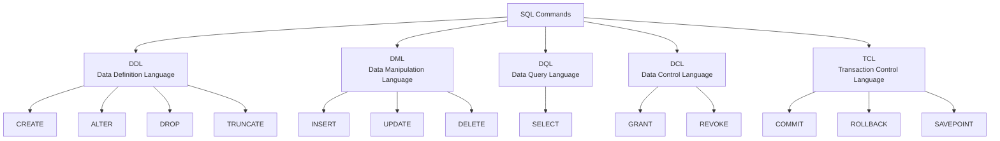

# Introduction to SQL

## What is SQL?

SQL stands for Structured Query Language. It is the standard language used to communicate with a relational database, a database that stores data in tables (rows and columns).

With SQL, you can:
- Create databases and tables
- Add, change, and delete data
- Ask questions about the data and get answers

Example of table (Students):

|StudentID|Name|Major|
|---|---|---|
|1|Ahmed|CS|
|2|Mohamed|IS|

SQL is supported by many systems: MySQL, PostgreSQL, SQL Server, Oracle, and SQLite. The basic commands are almost the same in all of them.

---

## Why Do We Need SQL?

- Manage large amounts of data. Imagine a university with 50,000 students. Searching a paper file or Excel sheet is slow, but SQL finds the data in seconds.
- Easy to learn. SQL commands look like English sentences, for example `SELECT Name FROM Students;`
- Fast data retrieval. You can filter, sort, and count data with one short command.
- Data accuracy and safety. SQL lets you set rules (for example, no two students with the same ID) and control who can see or change data.

## What is a Query?

A query is a request that you send to the database. You ask a question or give an instruction, and the database responds.

Example :

```sql
SELECT Name FROM Students WHERE Age > 20;
```
This means: _**Show me the names of all students older than 20.**_

## Types of SQL Commands



---

## Create A Database 

```sql
CREATE DATABASE database_name;
```

Example:

```sql
CREATE DATABASE UniversityDB;
```

## Deleting a Database

```sql
DROP DATABASE database_name;
```

Example: 

```sql
DROP DATABASE UniversityDB;
```

> [!warning]
> DROP DATABASE permanently deletes the database with all its tables and data. There is no undo. Always double-check the name before running it.


## Creating a Table

```sql
CREATE TABLE table_name (
    column1 datatype constraint,
    column2 datatype constraint
);
```

Example:

```sql
CREATE TABLE Students (
    StudentID INT PRIMARY KEY,
    Name VARCHAR(50) NOT NULL ,
    Major VARCHAR(50)
);
```

## Inserting Data into a Table

```sql
INSERT INTO table_name (column1, column2, ...)
VALUES (value1, value2, ...);
```

Example: Insert one row 

```sql
INSERT INTO Students (StudentID, Name, Major)
VALUES (1, 'Ahmed', 'CS');
```

Example: Insert many rows at once:

```sql
INSERT INTO Students (StudentID, Name, Major)
VALUES
    (2, 'Mohamed','IS'),
    (3, 'Omar','Software Engineering');
```

> [!Note]
> - Text values go inside single quotes `' '`
> - Numbers do not need quotes
> - The order of values must match the order of columns

 
## View Data

```sql
SELECT * FROM Students;
```

The `*` means **all columns**.

