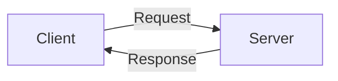
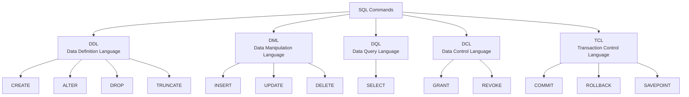

# Introduction to SQL

## What is a Database Management System (DBMS)?

A Database Management System (DBMS) is software that allows us to create, store, organize, manage, and retrieve data in databases.

It acts as an interface between users or applications and the database, allowing them to interact with data easily and efficiently.

**Examples of DBMS:**
- PostgreSQL
- MySQL
- Microsoft SQL Server
- Oracle Database

_We will use PostgreSQL as our DBMS and pgAdmin as a graphical tool to interact with and manage PostgreSQL._

## What is PostgreSQL?

- PostgreSQL is a powerful, open-source Relational Database Management System (RDBMS) used to store, organize, manage, and retrieve data.
- It uses SQL (Structured Query Language) to communicate with databases.

## Why PostgreSQL?

There are many database management systems available. PostgreSQL is a popular choice for several reasons:

|Feature|Description|
|---|---|
|Open Source|Free to use, and its source code is publicly available.|
|Extensible|Supports extensions and custom data types.|
|Cross-platform|Runs on Linux, Windows, and macOS.|


## How Does PostgreSQL Work?

PostgreSQL uses a Client-Server Architecture.

This architecture consists of two main components:



- **PostgreSQL Server**
  - The PostgreSQL Server is responsible for managing databases and handling requests from clients.
  - **Its responsibilities include:**
    - Accepting client connections.
    - Receiving and processing SQL statements.
    - Managing databases and their data.
    - Executing SQL queries.
    - Returning query results to clients.
- **PostgreSQL Client**
  - A PostgreSQL Client is an application that connects to the PostgreSQL Server to interact with databases.
  - Clients send SQL commands to the server and receive the results.
  - **Examples of PostgreSQL clients:**
    - **pgAdmin**: A graphical administration and development tool.
    - **psql**: A command-line tool for interacting with PostgreSQL.
    - **Applications**: Software applications can connect to PostgreSQL Server to interact with databases, execute SQL queries, and retrieve data.


## How Do We Connect to a Database Server?

To interact with a Database Server, we need a Database Client.
The client establishes a connection with the server using specific connection information.

Usually, we need the following information:

- **Host:**
  - The host identifies the machine where the PostgreSQL Server is running.
  - `localhost`: Means the server is running on the same machine as the client.
  - An IP address: Can be used when the server is running on another machine.
- **Port:**
  - A port is a communication endpoint used by applications to communicate over a network.
  - PostgreSQL uses **5432** as its default port. 
- **Username and Password**
  - PostgreSQL uses authentication to verify the identity of users before allowing them to connect.


## What is SQL?

SQL stands for Structured Query Language. It is the standard language used to communicate with a relational database, a database that stores data in tables (rows and columns).

With SQL, you can:
- Create databases and tables
- Add, change, and delete data
- Ask questions about the data and get answers

Example of table (Students):

|StudentID|Name|Major|
|---|---|---|
|1|Ahmed|CS|
|2|Mohamed|IS|

SQL is supported by many systems: MySQL, PostgreSQL, SQL Server, Oracle, and SQLite. The basic commands are almost the same in all of them.

---

## Why Do We Need SQL?

- Manage large amounts of data. Imagine a university with 50,000 students. Searching a paper file or Excel sheet is slow, but SQL finds the data in seconds.
- Easy to learn. SQL commands look like English sentences, for example `SELECT Name FROM Students;`
- Fast data retrieval. You can filter, sort, and count data with one short command.
- Data accuracy and safety. SQL lets you set rules (for example, no two students with the same ID) and control who can see or change data.

## What is a Query?

A query is a request that you send to the database. You ask a question or give an instruction, and the database responds.

Example :

```sql
SELECT Name FROM Students WHERE Age > 20;
```
This means: _**Show me the names of all students older than 20.**_

## Types of SQL Commands



---

## Create A Database 

```sql
CREATE DATABASE database_name;
```

Example:

```sql
CREATE DATABASE UniversityDB;
```

## Deleting a Database

```sql
DROP DATABASE database_name;
```

Example: 

```sql
DROP DATABASE UniversityDB;
```

> [!warning]
> **DROP DATABASE permanently deletes the database with all its tables and data. There is no undo. Always double-check the name before running it.**
>
> **You cannot drop a database while you are connected to it. You must connect to another database first.**

### Understanding the Database Structure

PostgreSQL uses a hierarchical structure to organize databases and their objects.

```
PostgreSQL Server
    |
    |--- Database 1
    |       |
    |       |--- Schema
    |       |      |
    |       |      |--- Table 1
    |       |      |--- Table 2
    |
    |--- Database 2
            |
            |--- Schema
                   |
                   |--- Table 1
``` 

- PostgreSQL Server
  - The PostgreSQL Server is the Database Management System responsible for managing databases and handling client connections.
  - A single PostgreSQL Server can manage multiple databases.
- Database
  - A Database is an organized collection of data and database objects.
  - Each database is independent of other databases managed by the same PostgreSQL Server.
- Schema
  - A Schema is a logical container used to organize database objects inside a database.
  - A database can contain multiple schemas, and each schema can contain objects
  - PostgreSQL creates a schema called public by default in a new database
- Table
  - A Table is a database object used to store data in rows and columns.
    - Columns: Define the attributes or properties of the data.
    - Rows: Represent individual records

## Creating a Table

```sql
CREATE TABLE table_name (
    column1 datatype constraint,
    column2 datatype constraint
);
```

For more details about datatypes:
- https://www.postgresql.org/docs/current/datatype.html
- https://neon.com/postgresql/tutorial/data-types
- https://www.cockroachlabs.com/blog/postgres-data-types/

Example:

```sql
CREATE TABLE students (
    student_id INTEGER,
    full_name VARCHAR(100),
    email VARCHAR(150),
    age SMALLINT,
    gpa NUMERIC(3,2),
    birth_date DATE,
    registration_date TIMESTAMP,
    is_active BOOLEAN,
    description TEXT
);
```

>[!Note]
> - DATE: Stores only the date (year, month, and day), without time.
> - TIMESTAMP: Stores both the date and time (hours, minutes, and seconds).

## Inserting Data into a Table

```sql
INSERT INTO table_name (column1, column2, ...)
VALUES (value1, value2, ...);
```

Example: Insert one row 

```sql
INSERT INTO students (
    student_id,
    full_name,
    email,
    age,
    gpa,
    birth_date,
    registration_date,
    is_active,
    description
)
VALUES (
           1,
           'Student 1',
           'Student@gmail.com',
           21,
           3.75,
           '2005-03-15',
           '2026-11-07 10:30:00',
           TRUE,
           'Computer Science student'
       );
```

Example: Insert many rows at once:

```sql
INSERT INTO students (
    student_id,
    full_name,
    email,
    age,
    gpa,
    birth_date,
    registration_date,
    is_active,
    description
)
VALUES
    (
        2,
        'Mohamed',
        'mohamed@gmail.com',
        22,
        3.50,
        '2004-06-20',
        '2026-11-07 11:00:00',
        TRUE,
        'Software Engineering student'
    ),
    (
        3,
        'Ahmed',
        'ahmed@gmail.com',
        20,
        3.90,
        '2006-01-10',
        '2026-11-07 11:30:00',
        TRUE,
        'Database student'
    ),
    (
        4,
        'Omar',
        'omar@gmail.com',
        23,
        2.85,
        '2003-09-12',
        '2026-11-07 12:00:00',
        FALSE,
        'Graduated student'
    );
```

> [!Note]
> - Text values go inside single quotes `' '`
> - Numbers do not need quotes
> - The order of values must match the order of columns

 
## View Data

```sql
SELECT * FROM students;
```

The `*` means **all columns**.


## Modifying Table Structure

### Adding a New Column

```sql
ALTER TABLE table_name
ADD COLUMN column_name data_type;
```

Example:

```sql
ALTER TABLE students
ADD COLUMN phone VARCHAR(20);
```

### Renaming a Column

```sql
ALTER TABLE table_name
RENAME COLUMN old_name TO new_name;
```

Example:

```sql
ALTER TABLE students
RENAME COLUMN full_name TO student_name;
```

### Changing a Column's Data Type

```sql
ALTER TABLE table_name
ALTER COLUMN column_name TYPE data_type;
```

Example:

```sql
ALTER TABLE students
ALTER COLUMN age TYPE BIGINT;
```

### Deleting a Column

```sql
ALTER TABLE table_name
DROP COLUMN column_name;
```

Example:

```sql
ALTER TABLE students
DROP COLUMN phone;
```

### Renaming a Table

```sql
ALTER TABLE table_name
RENAME TO new_table_name;
```

Example:

```sql
ALTER TABLE students
RENAME TO university_students;
```


## Task: University Database

- Create a database named university_db.
- Create a table named departments with the following columns:
  - department_id – INTEGER
  - department_name – VARCHAR(100)
  - location – VARCHAR(100)
- Insert at least 3 departments.
- Display all records.
- Add a new column named phone.
- Rename the column location to building.
- Change the data type of phone to TEXT.